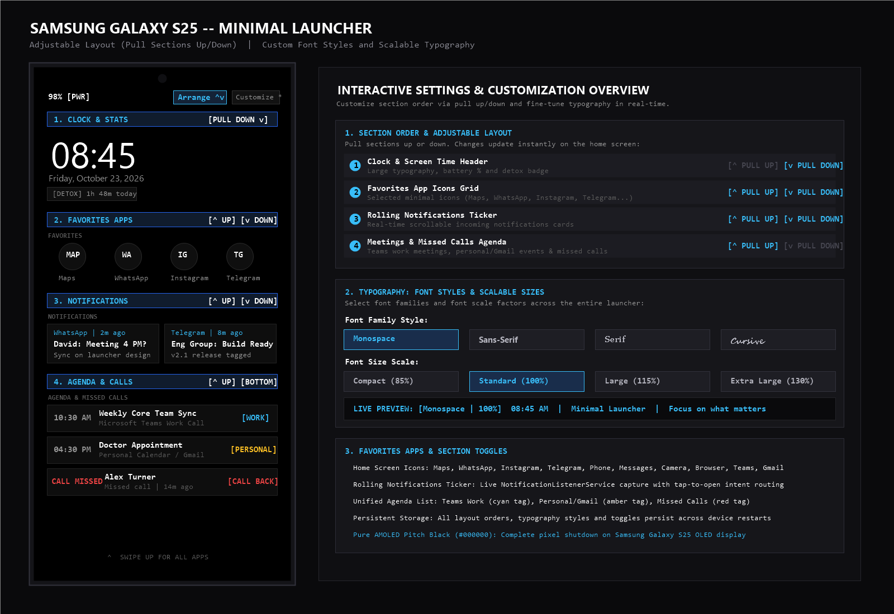

# Minimal Launcher — Samsung Galaxy S25 Edition

An ultra-clean, battery-efficient Kotlin Jetpack Compose Android launcher engineered for the Samsung Galaxy S25 / S25+ / S25 Ultra (Dynamic AMOLED 2X, 120Hz display, `targetSdk 34`, `minSdk 26`).

## What's New: Adjustable Layout & Typography Customization

### 1. Adjustable Home Screen Layout (Pull Sections Up / Down)
You can completely customize the visual order of your home screen:
- **Direct Home Screen Reordering**: Tap **"Arrange ⇅"** in the top header to enter Arrange Mode. Each section displays **`[▲ PULL UP]`** and **`[▼ PULL DOWN]`** buttons allowing you to immediately swap sections into your preferred position.
- **Settings Menu Layout Manager**:
  - Reorder all 4 core sections:
    1. **Clock & Screen Time Header**
    2. **Favorites App Icons Grid**
    3. **Rolling Notifications Ticker**
    4. **Meetings & Missed Calls Agenda**
  - **1-Tap Quick Presets**:
    - `Default`: Clock → Favorites → Notifications → Agenda
    - `Agenda First`: Agenda → Clock → Favorites → Notifications
    - `Apps First`: Favorites → Clock → Notifications → Agenda
  - Layout orders are automatically saved to `SharedPreferences ("s25_launcher_prefs")` and persist across device restarts.

### 2. Typography: Font Families & Scalable Sizes
- **4 Selectable Font Family Styles**:
  - **Monospace**: Clean coding & hacker minimal aesthetic (`FontFamily.Monospace`).
  - **Sans-Serif**: Modern OneUI sleek aesthetic (`FontFamily.SansSerif`).
  - **Serif**: Classic editorial refinement (`FontFamily.Serif`).
  - **Cursive**: Casual handwriting aesthetic (`FontFamily.Cursive`).
- **4 Font Size Scale Factors**:
  - **Compact**: 85% scale for high information density.
  - **Standard**: 100% default optimal size.
  - **Large**: 115% scale for enhanced readability.
  - **Extra Large**: 130% bold prominence.
- **Live Interactive Typography Preview**: See how the clock, dates, and labels will look before closing settings.

---

## Core Sections & Features

### Section 1: Minimal Favorites App Icons
- Clean monochrome circular icons in a responsive grid.
- Quick-toggle options in Settings: **Maps**, **WhatsApp**, **Instagram**, **Telegram**, **Phone**, **Messages**, **Camera**, **Browser (Chrome/Samsung Internet)**, **Microsoft Teams**, **Gmail**, and **Photos**.
- Direct launch with auto-detection of Samsung OneUI & Google system packages.

### Section 2: Rolling Notifications (Scrollable Ticker)
- Small, horizontal scrollable cards (`LazyRow`) displaying incoming alerts in real-time.
- Captures sender, title, message snippet, and timestamp.
- Backed by an Android `NotificationListenerService` (`S25NotificationService`) with tap-to-open direct intent resolution.

### Section 3: Meetings & Missed Calls (Minimal Mode)
- **Microsoft Teams (Work)**: Minimal tagged calendar meetings (`[WORK]` cyan tag).
- **Personal & Gmail**: Google Calendar events and reminders (`[PERSONAL]` amber tag).
- **Missed Calls**: Live call log alerts (`[MISSED CALL]` red tag) with one-tap dial back.
- Integrated with Android `CalendarContract` and `CallLog.Calls` runtime permissions.

---

## Intuitive Gestures & AMOLED Power Efficiency
- **Pure AMOLED Pitch Black (`#000000`)**: Complete pixel shutdown on Samsung OLED displays for maximum battery life.
- **Hero Status Header**: Large digital clock, date, battery percentage with `⚡` charging indicator, and screen time detox badge (`⏳ 1h 48m today`).
- **Swipe UP**: Slides up the full alphabetical All-Apps drawer with live search.
- **Swipe RIGHT**: Instant quick-launch Phone / Dialer.
- **Swipe LEFT**: Instant quick-launch Camera.
- **Automated CI/CD**: GitHub Actions workflow (`.github/workflows/build.yml`) compiling `app-debug.apk` using Java 17 (Temurin) and Gradle 8.7.
